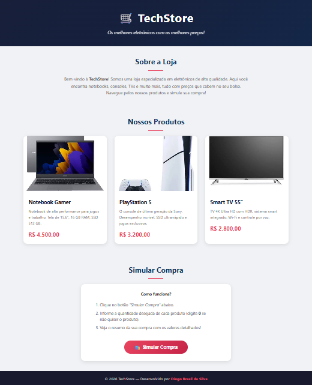

# 🛒 Simulador de Compras — TechStore

**Aluno:** Diogo Brasil da Silva  
**Trilha:** Desenvolvimento Mobile

---

## 📋 Apresentação da Loja

A **TechStore** é uma loja fictícia de eletrônicos que oferece produtos de alta qualidade a preços acessíveis. O projeto simula uma experiência de compra onde o usuário pode escolher quantidades de produtos e receber um resumo detalhado do pedido.

## 🛍️ Produtos e Preços

| Produto        | Descrição                                                       | Preço       |
| -------------- | --------------------------------------------------------------- | ----------- |
| Notebook Gamer | Notebook de alta performance, tela 15.6", 16 GB RAM, SSD 512 GB | R$ 4.500,00 |
| PlayStation 5  | Console de última geração da Sony, SSD ultrarrápido             | R$ 3.200,00 |
| Smart TV 55"   | TV 4K Ultra HD com HDR, sistema smart integrado                 | R$ 2.800,00 |

## 🚀 Tecnologias Utilizadas

- **HTML5** — Estrutura da página
- **CSS3** — Estilização, layout responsivo com CSS Grid e gradientes
- **JavaScript** — Lógica de simulação de compra com `prompt()` e `alert()`

## 📁 Estrutura do Projeto

```
desafio-trilhas/
├── index.html      # Página principal
├── style.css       # Estilos da página
├── script.js       # Lógica de simulação de compra
├── README.md       # Documentação do projeto
├── instrucoes.md   # Instruções do desafio
└── assets/
    ├── notebook.jpg
    ├── ps5.jpg
    └── tv.jpg
```

## ▶️ Instruções de Execução

1. Clone ou baixe este repositório.
2. Abra o arquivo `index.html` em qualquer navegador moderno (Chrome, Firefox, Edge, etc.).
3. Clique no botão **"Simular Compra"** para iniciar a simulação.
4. Informe a quantidade desejada de cada produto (ou 0 para não comprar).
5. Veja o resumo completo da sua compra!

## 🖼️ Tela Inicial



## 🧪 Testes Realizados

| Cenário                          | Resultado Esperado                    | Status |
| -------------------------------- | ------------------------------------- | ------ |
| Comprar 1 de cada produto        | Total = R$ 10.500,00                  | ✅     |
| Comprar apenas 2 notebooks       | Total = R$ 9.000,00                   | ✅     |
| Todas as quantidades = 0         | Mensagem "Nenhum produto selecionado" | ✅     |
| Digitar texto ao invés de número | Tratar como 0 (não comprar)           | ✅     |
| Cancelar o prompt                | Tratar como 0 (não comprar)           | ✅     |
| Digitar número negativo          | Tratar como 0 (não comprar)           | ✅     |

## 💡 Dificuldades e Aprendizados

**Dificuldade encontrada:** Tratar entradas inválidas do usuário nos `prompt()`, como textos, valores negativos ou quando o usuário clica em "Cancelar".

**O que aprendi:** Aprendi a usar `Number()` para converter strings em números e a verificar valores inválidos com `isNaN()`. Também aprendi a formatar valores monetários em JavaScript usando `toFixed(2)` e `replace(".", ",")` para o padrão brasileiro.

## 🤖 Uso de IA

Este projeto foi desenvolvido com o auxílio de uma IA (Antigravity/Claude). A IA ajudou na estruturação do código HTML, na criação do CSS responsivo e na lógica do JavaScript. Todos os códigos foram revisados e adaptados para atender aos requisitos do desafio. A verificação foi feita testando cada cenário de compra manualmente no navegador, conferindo que os preços exibidos na página correspondem aos usados no JavaScript e que todas as situações de entrada (valores válidos, zero, inválidos e cancelamento) são tratadas corretamente.
